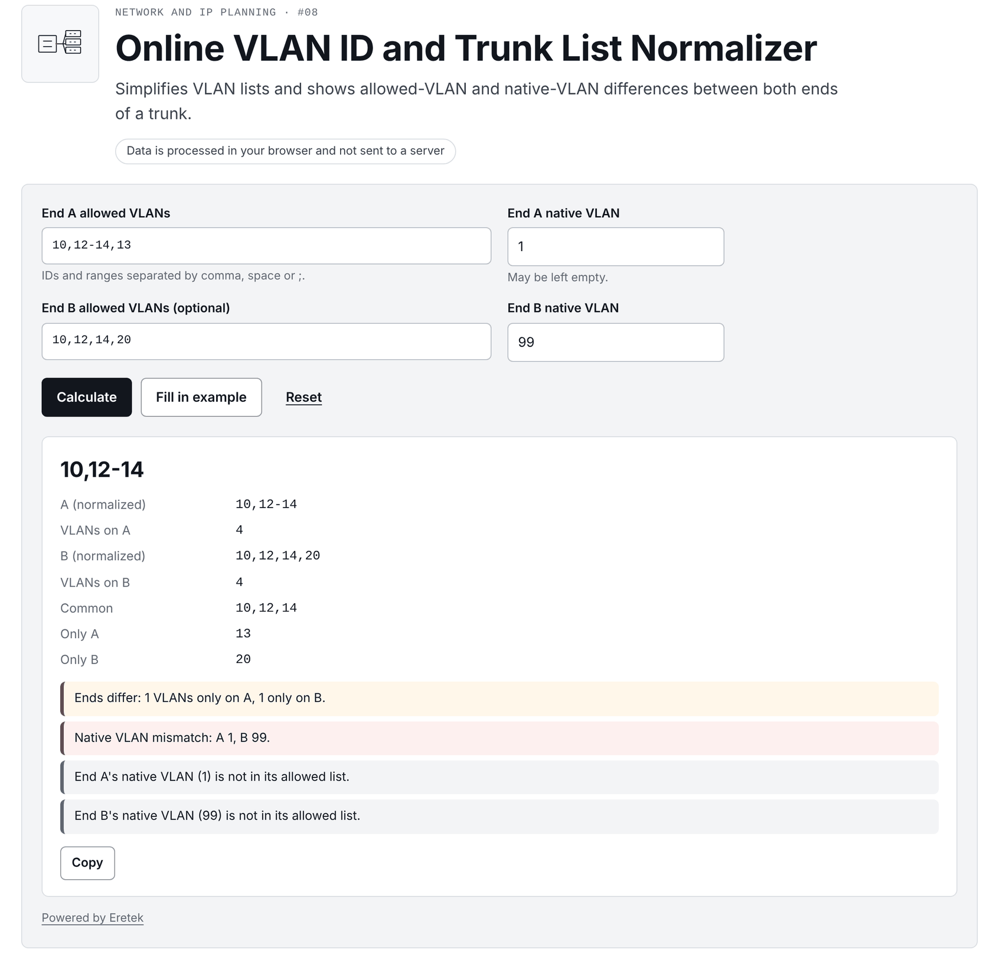

# VLAN ID and Trunk List Normalizer

Normalize a trunk allowed VLAN list; find common and different VLANs and native VLAN mismatches between two trunk ends. 802.1Q range 1–4094.

## Try it live

- [Türkçe](https://network.eretek.com/araclar/vlan-trunk-listesi)
- [English](https://network.eretek.com/en/tools/vlan-trunk-list)
- [Deutsch](https://network.eretek.com/de/werkzeuge/vlan-trunk-liste)



## What it does

Simplifies VLAN lists and shows allowed-VLAN and native-VLAN differences between both ends of a trunk.

A VLAN allowed on one end of a trunk but not the other silently cuts off part of that VLAN. A native VLAN mismatch puts untagged traffic into the wrong VLAN. The tool compares both ends and rewrites the list in a short form you can paste into devices.

## Where it helps

Paste the normalized list straight into `switchport trunk allowed vlan`. The 'only A' and 'only B' rows are the VLANs to add or remove on one end.

## How to use it

1. Enter end A's allowed VLAN list (`10,12-14,20`); spaces and semicolons also work as separators.
2. For a comparison, enter end B and both native VLANs (optional).
3. Press Calculate.

### Fields

| Field | Description |
|---|---|
| End A allowed VLANs | IDs and ranges separated by comma, space or ;. |
| End A native VLAN | May be left empty. |
| End B allowed VLANs (optional) |  |
| End B native VLAN |  |

## Example input

Press **Fill in example** in the tool to load this input.

| Input | Value |
|---|---|
| End A allowed VLANs | `10,12-14,13` |
| End A native VLAN | `1` |
| End B allowed VLANs (optional) | `10,12,14,20` |
| End B native VLAN | `99` |

**Expected result:** A: 10,12-14 (duplicate 13 and order fixed); B: 10,12,14,20; common 10,12,14; only on A 13; only on B 20; native 1 ≠ 99.

## Method and assumptions

The list is expanded into a set of integers, sorted and consecutive values written back as ranges. Usable 802.1Q VLAN IDs are 1–4094; 0 and 4095 are reserved.

Comparison uses set intersection and differences. A native VLAN that is not in the allowed list is reported.

## Limits and common mistakes

- Vendor-specific reserved ranges are not applied without a verified profile; check your device documentation.
- It does not connect to devices; it compares the lists you enter.

## Run it locally

The tool is plain HTML, CSS and JavaScript with no build step and no dependencies.

```bash
git clone https://github.com/eretek/vlan-trunk-list.git
cd vlan-trunk-list
node scripts/serve.js        # or: python3 -m http.server 8080
```

Open <http://127.0.0.1:8080/>. Add `?lang=tr` or `?lang=de` for Turkish or German; without it the page follows the browser language and falls back to English. You can also open `index.html` directly from disk.

Run the tests (Node.js 18 or later):

```bash
node test/run.js    # or: npm test
```

The tests run the tool's own fixtures and the worked examples in all three languages without a browser.

## How it works

All processing happens in your browser. The tool makes no network requests, uses no cookies or browser storage, and does not upload files you select.

No server-side component is needed. The version on the Eretek website renders the same page through a private WordPress plugin; that plugin only produces the page markup and is not part of this repository.

| Path | Purpose |
|---|---|
| `index.html` | Page shell |
| `src/app.js` | Builds the page in Turkish, English or German from `src/data.js` |
| `src/data.js` | Field definitions, examples and all texts in three languages |
| `src/core.js` | Shared runtime: validation, number formats, result rendering, CSV/ICS export |
| `src/tool.js` | The calculation or analysis for this tool |
| `docs/screenshot.png` | Screenshot used in this README |
| `src/tools.css`, `src/page.css` | Styles |
| `test/run.js`, `test/cases.json` | Headless tests |

## License and attribution

This tool is released under the [Eretek Website Attribution License](LICENSE). You may use, modify and redistribute it, including commercially. If you make it available on a website or web application, show a visible, clickable credit linking to https://eretek.com/ on every page where the tool is available, for example:

```html
<a href="https://eretek.com/">Powered by Eretek</a>
```

You may add `rel="nofollow"` to the link. Keep the copyright notice and license text in copies and redistributions.
